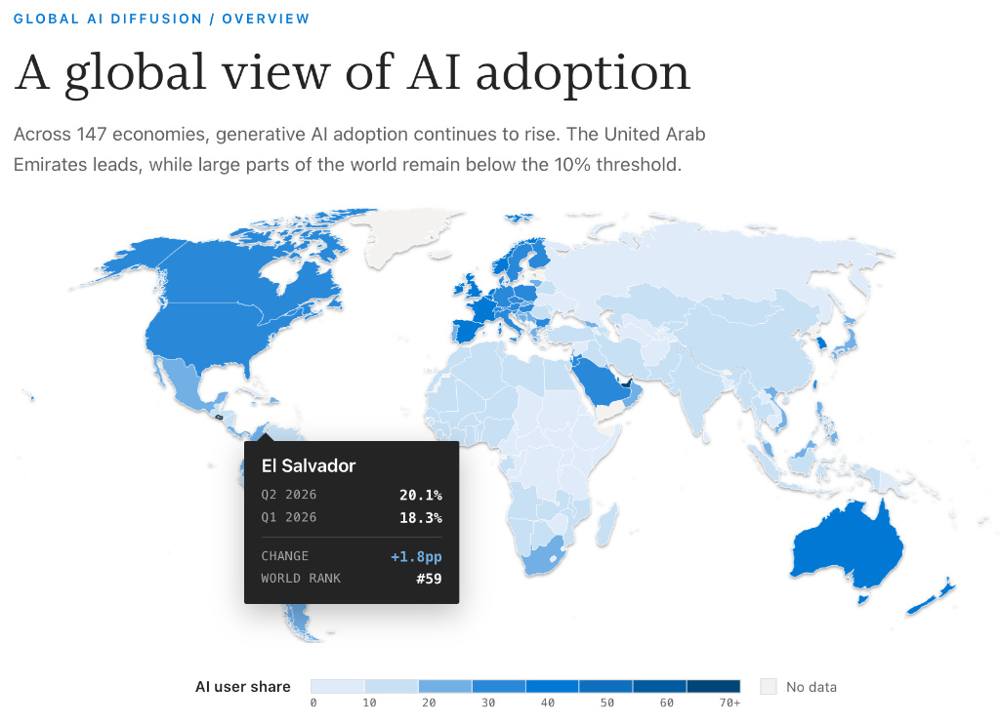
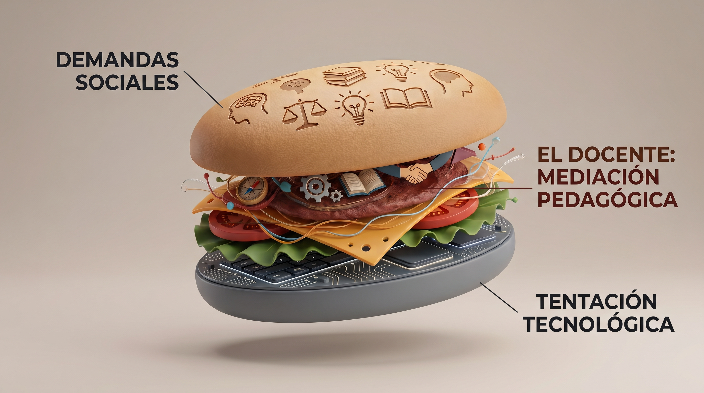
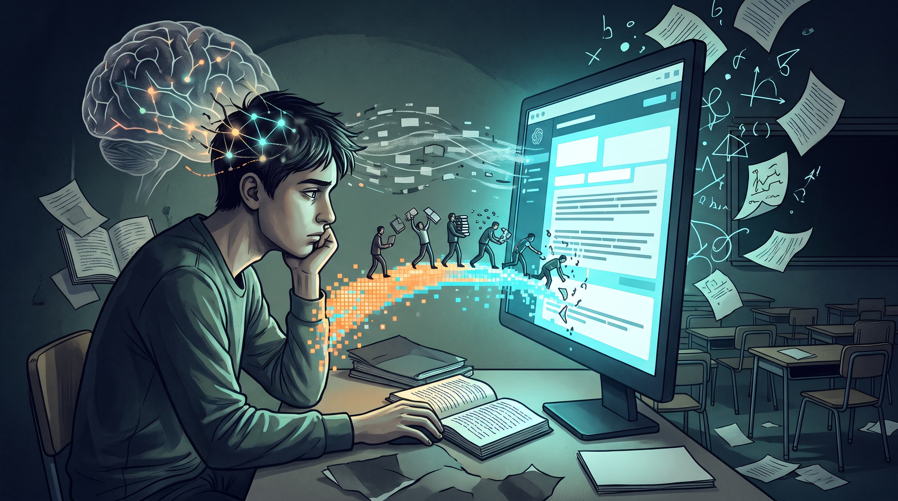

# Módulo 1A: La IA llegó para quedarse: ¿Cómo la recibe un docente?

**Taller 1 – Parte A (13:15 – 15:00)**\
*Actitudes, emociones y el modelo de profesionalidad docente frente a los algoritmos en la escuela*

## 1. ¿Qué se espera lograr en este módulo?

Se espera que los docentes:

- **Reconozcan y legitimen sus vivencias emocionales** y actitudes iniciales frente a la IA mediante herramientas de mediación reflexiva.
- **Analicen críticamente las prácticas** que ya observan en sus aulas salvadoreñas frente al acceso a teléfonos móviles y asistentes de texto.
- **Comprendan la evolución histórica** del fenómeno de la descarga cognitiva (*Cognitive Offloading*) desde la escritura hasta los modelos generativos.
- **Diferencien con rigor conceptual** los sistemas digitales deterministas de los Modelos de Lenguaje de Gran Escala (LLM estocásticos y probabilísticos).
- **Sitúen su práctica dentro del Modelo Multicomponente de la Profesionalidad Docente** [@ittner2019] y los estratos del saber [@neuweg2014] para consolidar su autonomía pedagógica.

------------------------------------------------------------------------

## 2. Punto de partida vivencial: De la emoción al criterio docente (25 Minutos)

Toda innovación tecnológica irrumpe primero en el plano afectivo. Antes de debatir sobre algoritmos, aplicaciones o metodologías, el docente experimenta sensaciones encontradas: el asombro ante la velocidad de la máquina, la inquietud ante la pérdida de control en las tareas, la sospecha frente al engaño y el cansancio ante una nueva exigencia del sistema educativo.

En la pedagogía reflexiva, estas reacciones no se reprimen: se escuchan. Detrás de cada emoción intensa existe una necesidad profesional legítima: certeza, tiempo, justicia evaluativa o sentido pedagógico.

::: callout-note
### Dinámica vivencial: Cartas de resonancia emocional (En sala)

- **Paso 1 (Selección individual - 4 min):** En la mesa central se dispone una colección de tarjetas visuales de asesoramiento. Cada participante escoge en silencio la imagen que mejor represente lo que experimenta internamente frente a la presencia de la IA en el entorno escolar.
- **Paso 2 (Tríadas reflexivas - 10 min):** En grupos de tres docentes, cada persona comparte su tarjeta guiándose por tres preguntas:
  1.  ¿Qué rasgo de la imagen conecta con mi estado afectivo actual (desconfianza, asombro, agobio, esperanza, alivio)?
  2.  ¿Con qué situación concreta de mi práctica escolar o centro educativo relaciono esta imagen?
  3.  ¿Qué necesidad profesional legítima subyace a esta emoción?
- **Paso 3 (Cartografía mural - 11 min):** En un papelógrafo mural, la facilitación traza dos ejes perpendiculares que dividen el espacio en cuatro cuadrantes:
:::

::: {.callout-note appearance="simple"}
## 🧭 ¿Dónde nos ubicamos frente a la IA? (Matriz de Reacción Emocional)

<details>
<summary><b>Haga clic aquí para revelar los cuadrantes y contrastar su postura inicial</b></summary>

<br>

| | Postura pasiva / Reactiva (Evitar o esperar) | Disposición activa / Propositiva (Explorar y actuar) |
|:---|:---|:---|
| **Valencia alta / Apertura**<br>*(Curiosidad, asombro, alivio)* | **Cuadrante II: Fascinación pasiva**<br>«Veo mucho potencial o magia técnica, pero no sé cómo guiarlo ni qué hacer en el aula.» | **Cuadrante I: Acción propositiva**<br>«Reconozco oportunidades claras y quiero diseñar experiencias de aprendizaje enriquecidas.» |
| **Valencia baja / Alerta**<br>*(Preocupación, fatiga, desconfianza)* | **Cuadrante III: Resistencia o parálisis**<br>«Siento rechazo o temor ante el engaño; preferiría prohibir o ignorar estas herramientas.» | **Cuadrante IV: Criterio crítico activo**<br>«Me preocupa el atajo cognitivo y el plagio, por eso asumo el reto de rediseñar tareas resistentes.» |

</details>
:::

::: callout-tip
### Guía para el estudio autónomo asincrónico

Observe las siguientes cinco metáforas visuales habituales en procesos de asesoramiento profesional. Elija una y reflexione por escrito en su cuaderno:

- **A. La Brújula:** Necesidad de orientación conceptual clara ante la niebla técnica.
- **B. La Marioneta:** Temor a perder la soberanía y ser dirigido por plataformas comerciales.
- **C. La Avalancha:** Sensación de verse sobrepasado por una velocidad tecnológica inasumible.
- **D. Las Manos en la Arcilla:** Convicción de que la tecnología requiere el toque humano para cobrar valor pedagógico.
- **E. El Espejo:** Oportunidad para reflexionar sobre lo que la máquina jamás podrá sustituir de mi labor docente.
:::

------------------------------------------------------------------------

## 3. La perspectiva de la realidad escolar salvadoreña (15 Minutos)

Los datos globales más recientes confirman que la inteligencia artificial generativa ya no es un fenómeno lejano: en **El Salvador, el 20.1 % de la población activa ya utiliza herramientas de IA generativa en 2026** (ocupando el puesto #59 a nivel mundial, con un crecimiento sostenido trimestre a trimestre).

::: {#fig-mapa-adopcion}
{fig-align="center" width="88%"}

**Adopción global de IA generativa:** El Salvador alcanza un 20.1 % de cuota de usuarios en 2026 (Puesto #59 a nivel mundial).\
*Fuente:* Datos extraídos del informe oficial [Microsoft AI Economy Institute: Global AI Diffusion Report](https://www.microsoft.com/en-us/corporate-responsibility/topics/ai-economy-institute/reports/global-ai-diffusion-report/){target="_blank"}.
:::

Partiendo de esta realidad empírica y de la experiencia viva de las y los docentes que trabajan a diario en las escuelas salvadoreñas, analizamos tres situaciones recurrentes en el aula:

| Situación observada en el aula | Diagnóstico didáctico: El problema de fondo | Potencial formativo: Dónde podría haber valor |
|:---|:---|:---|
| **A. La copia literal instantánea:**<br>Entregas con vocabulario o giros lingüísticos que el estudiante nunca utiliza oralmente en clase. | **Descarga cognitiva absoluta:** Se anula el esfuerzo de redactar, dudar y estructurar. No se consolida aprendizaje. | Evidencia destreza técnica en el manejo de interfaces y comandos de búsqueda. |
| **B. La consulta privada por inseguridad:**<br>El alumno que no se atreve a preguntar al docente por vergüenza y pide explicaciones al bot. | **Riesgo de falso entendimiento:** Seguir la explicación del bot genera una ilusión de dominio que se desmorona sin la pantalla. | **Andamiaje adaptativo:** Permite repasar conceptos a ritmo propio y sin juicio social. |
| **C. El resumen automático:**<br>Pedir al chatbot que resuma un libro o artículo para evitar la lectura completa. | **Atrofia de la lectura profunda:** Se pierde la capacidad de sostener la atención ante textos complejos o contradictorios. | Puede servir como esquema de contraste posterior a la lectura íntegra. |

------------------------------------------------------------------------

## 4. Fundamentación conceptual: La historia del Cognitive Offloading (20 Minutos)

El concepto de *Cognitive Offloading* [@risko2016] demuestra que delegar tareas mentales a herramientas externas forma parte del desarrollo cultural humano:

1.  **Libros y escritura:** Nos liberaron de memorizarlo todo $\rightarrow$ *Exigencia resultante:* Desarrollar lectura crítica e interpretación de fuentes.

2.  **Calculadoras:** Nos liberaron del cálculo aritmético mecánico $\rightarrow$ *Exigencia resultante:* Comprender qué operaciones aplicar y formular modelos matemáticos.

3.  **Buscadores en Internet:** Nos liberaron del archivo físico $\rightarrow$ *Exigencia resultante:* Curar, filtrar y verificar fiabilidad de datos.

4.  **Máquinas generativas (LLM):** Prometen redactar borradores, resumir y argumentar $\rightarrow$ *Exigencia resultante:* Gobernar la herramienta, auditar alucinaciones y ejercer juicio ético.

Las investigaciones de Risko y Gilbert (2016) revelan una consecuencia paradójica: al externalizar nuestras tareas cognitivas a herramientas tecnológicas, nuestra retención y memoria biológica se resienten de manera medible\[cite: 37, 38\]. Cuando usamos un sistema de memoria externa, el cerebro cambia su prioridad y pasa de recordar el «qué» (el contenido) a recordar simplemente el «dónde» (la ubicación de la información)\[cite: 37\].

::: {.callout-note appearance="simple"}
## 🧠 Los costos ocultos de delegar el pensamiento

<details>

<summary><b>Haga clic aquí para desplegar los hallazgos empíricos sobre el impacto del Offloading (Risko & Gilbert, 2016)</b></summary>

<br>

- **La transición del «Qué» al «Dónde»:** En entornos digitales, si las personas esperan que un dato se guarde en la computadora, su recuerdo del contenido disminuye, pero mejora su capacidad para recordar la ruta o ubicación donde encontrarlo.
- **El efecto GPS (Deterioro de la memoria espacial):** Externalizar la orientación y navegación a un dispositivo de mapas perjudica la memoria espacial, provocando que los individuos tengan un rendimiento más pobre al intentar recorrer la misma ruta por segunda vez sin la ayuda tecnológica.
- **Amnesia por fotografía:** El acto de tomar una foto hace que las personas deleguen el esfuerzo de retención en la cámara, lo que deteriora posteriormente su memoria sobre los objetos que fueron fotografiados.
- **Ilusión de conocimiento (Inflación metacognitiva):** Buscar información en Internet provoca que los individuos confundan los datos de la red con su propia memoria, llevándolos a creer erróneamente que tienen más conocimientos almacenados «en la cabeza» de los que realmente poseen.

</details>
:::

::: {.callout-note appearance="simple"}
## 📖 Glosario Conceptual: Cognitive Offloading y Procesos Relacionados

<details>

<summary><b>Haga clic aquí para desplegar el glosario técnico (Risko & Gilbert, 2016, p. 677)</b></summary>

<br>

- **Cognitive offloading:** Uso de una acción física para alterar los requisitos de procesamiento de información de una tarea con el fin de reducir la demanda cognitiva [@risko2016].
- **External normalization:** Uso de una acción física (por ejemplo, inclinar la cabeza) para alinear un estímulo con una representación almacenada en la memoria [@risko2016].
- **Feeling-of-knowing:** Predicciones realizadas por un individuo sobre si será capaz de recuperar información específica [@risko2016].
- **Intention offloading:** Creación de una señal en el entorno externo para activar una intención diferida [@risko2016].
- **Internal normalization:** Uso de una transformación interna (es decir, rotación mental) para alinear la representación interna de un estímulo con una representación almacenada en la memoria [@risko2016].
- **Metacognition:** Pensamiento de orden superior, o «pensar sobre el pensamiento», para permitir la evaluación y el control de los propios procesos mentales [@risko2016].
- **Stroop task:** Tarea de tiempo de reacción que implica un conflicto entre dos dimensiones de estímulo (por ejemplo, el color y el significado de estímulos de palabras) [@risko2016].
- **Transactive memory system:** Sistema de memoria compuesto por un grupo que codifica, almacena y recupera conocimientos de forma colectiva [@risko2016].

</details>
:::

### Sistemas deterministas frente a modelos probabilísticos (LLM)

- **Sistemas deterministas (TIC tradicionales):** Operan bajo reglas causales formales: ante un mismo *input*, arrojan siempre el mismo *output*.
- **Modelos probabilísticos (LLM):** Redes neuronales profundas que calculan la probabilidad estadística de qué palabra debe seguir a la anterior según patrones masivos de entrenamiento. Su objetivo es la **plausibilidad formal**, no la verdad del mundo real.
- **La alucinación estructural:** Al optimizar la coherencia del texto por encima de la exactitud empírica, el modelo genera con elocuencia datos erróneos, fechas falsas y citas inexistentes.

### La escuela en el «Sándwich Didáctico» (Wolfgang Spahn)

{fig-align="center" width="85%"}

- **Pan superior (Demanda social):** Formar pensamiento de orden superior, criterio ético, creatividad y argumentación compleja.
- **El centro del sándwich (El profesorado):** La mediación docente es la única instancia capaz de arbitrar esta contradicción mediante consignas resistentes.
- **Pan inferior (Tentación técnica):** Herramientas que ofrecen comodidad mental inmediata (*cognitive ease*), suprimiendo la fricción cognitiva necesaria para aprender.

::: callout-warning
### [Alerta crítica: El riesgo de la «Skillflation» y la falsa adaptación neoliberal [@bettinger2021; @kalz2023]]{style="font-size: 1.1em;"}

Al discutir la alfabetización digital, el debate contemporáneo suele verse inundado de modas conceptuales (*21st Century Skills*, *Future Skills*), fenómeno que la investigación denuncia como **«Skillflation»** [@kalz2023; @bettinger2021]: la invención constante de nuevas etiquetas en inglés para designar fines pedagógicos clásicos.

Desde una lectura crítica de la gubernamentalidad [@bettinger2021], estas listas a menudo promueven una lógica de mera *adaptación al mercado tecnológico*, concibiendo al estudiante como un simple «gestor de su propio capital humano». Frente a este sesgo, afirmamos con rigor:

1.  **No hay competencia sin contenido:** Pretender enseñar «pensamiento crítico» en el vacío, sin un sólido dominio disciplinar, produce una erosión del conocimiento.
2.  **Emancipación vs. Adaptación:** La meta de la educación no es ajustar a los jóvenes pasivamente a las plataformas corporativas, sino dotarlos de autonomía, criterio ético y soberanía pedagógica (*Human Agency*).
:::

------------------------------------------------------------------------

## 5. Evidencia científica sobre cognición y aprendizaje (15 Minutos)

{fig-align="center" width="85%"}

**Lectura introductoria: El precio del atajo digital**

Aunque la IA generativa ofrece respuestas inmediatas y reduce la carga cognitiva, la ciencia advierte sobre un costo oculto [@stadler2024]. Estudios recientes revelan que delegar el pensamiento a los LLM disminuye la profundidad de la argumentación y debilita la conectividad neuronal necesaria para el aprendizaje a largo plazo [@kosmyna2025]. Al usar la IA sin barreras didácticas, ganamos velocidad técnica, pero sacrificamos nuestra autonomía cognitiva.

- **Acumulación de deuda cognitiva (*Cognitive Debt*, @kosmyna2025):** Al monitorizar a estudiantes durante cuatro meses en tareas de redacción asistidas por IA, la actividad en la corteza prefrontal y áreas de memoria de trabajo disminuyó sensiblemente. Aunque los textos finales eran gramaticalmente avanzados, la retención conceptual a largo plazo cayó y los estudiantes fueron incapaces de defender sus tesis sin la pantalla.
- **Facilidad cognitiva a expensas de la profundidad [@stadler2024]:** La comodidad de obtener respuestas inmediatas (*cognitive ease*) redujo de forma estadísticamente significativa la profundidad argumentativa y el cuestionamiento crítico.
- **Peligro de la falta de barreras didácticas (*Guardrails*, @bastani2025):** En secundaria, los estudiantes que resolvieron matemáticas con acceso libre a bots conversacionales rindieron peor en exámenes individuales sin tecnología que aquellos que trabajaron con métodos tradicionales.

::: {.callout-note appearance="simple"}
## 📖 Glosario Conceptual: El impacto de la IA en la cognición

<details>

<summary><b>Haga clic aquí para desplegar los conceptos clave (Kosmyna, 2025; Stadler, 2024)</b></summary>

<br>

- **Teoría de la Carga Cognitiva (Cognitive Load Theory - CLT):** Postula que la memoria de trabajo humana tiene una capacidad limitada que es crucial para el aprendizaje. El diseño instruccional y las herramientas digitales juegan un rol fundamental en exacerbar o aliviar esta carga [@stadler2024].
- **Carga Cognitiva Intrínseca (Intrinsic Cognitive Load - ICL):** La carga mental que está directamente vinculada a la complejidad del material de aprendizaje en sí mismo [@stadler2024].
- **Carga Cognitiva Extrínseca (Extraneous Cognitive Load - ECL):** La carga impuesta por la manera en que se presenta la información a los estudiantes, como la necesidad de discernir entre información relevante e irrelevante durante una búsqueda [@stadler2024].
- **Carga Cognitiva Germana (Germane Cognitive Load - GCL):** El esfuerzo mental dedicado a construir y automatizar esquemas que apoyan el aprendizaje. El uso de LLMs reduce esta carga, lo que disminuye el compromiso profundo con el material [@stadler2024].
- **Facilidad Cognitiva (Cognitive Ease):** La reducción de la carga cognitiva intrínseca y extrínseca al obtener respuestas directas y sintetizadas de la IA. Aunque aumenta la eficiencia, los estudiantes generan argumentaciones de menor calidad en comparación con la búsqueda en la web tradicional [@stadler2024].
- **Deuda Cognitiva (Cognitive Debt):** La disminución de la retención a largo plazo y de las habilidades de resolución independiente de problemas debido a una excesiva dependencia de los sistemas de IA [@kosmyna2025].
- **Cámaras de Eco (Echo Chambers):** Sistemas cerrados donde se excluyen otras voces, amplificando o reforzando creencias existentes. Los LLMs pueden exacerbar esto al proveer respuestas únicas basadas en la predicción de tokens, limitando la exposición a perspectivas diversas [@kosmyna2025].
- **Conectividad Neuronal (Neural Connectivity):** La interacción y sincronización de las redes cerebrales durante tareas complejas. Escribir sin asistencia aumenta significativamente la conectividad en bandas theta y alfa (vinculadas a la memoria y el control ejecutivo), mientras que el uso de IA reduce estas interacciones neuronales [@kosmyna2025].

</details>
:::

------------------------------------------------------------------------

## 6. Modelo de referencia: El Modelo Multicomponente de la Profesionalidad Docente (15 Minutos)

*(Adaptado de Ittner, 2019)*

```{mermaid}
%%| fig-cap: "Los Tres Estratos del Saber Docente frente a la IA [@neuweg2014]"
%%| fig-align: center
flowchart LR
    S1["<b>SABER 1: Codificado</b><br><i>El saber de la formación</i><br>───────────────<br>• Manuales, libros y datos<br>• Contenidos formales<br><br>⚠️ <b>Vulnerable a LLMs</b><br>(Copia instantánea)"]
    
    S2["<b>SABER 2: Interiorizado</b><br><i>Estructuras mentales</i><br>───────────────<br>• Modelos mentales propios<br>• Duda y esquemas internos<br><br>🧠 <b>Esfuerzo Biológico</b><br>(Fricción y sinapsis)"]
    
    S3["<b>SABER 3: En la Acción</b><br><i>El saber cómo / la acción</i><br>───────────────<br>• Pericia práctica en el aula<br>• Relación viva con alumnos<br><br>🛡️ <b>Irreductible</b><br>(Juicio humano situado)"]

    S1 ==>|"Interiorización<br>reflexiva"| S2
    S2 ==>|"Manifestación<br>en contexto"| S3

    style S1 fill:#fff5f5,stroke:#e03131,stroke-width:2px,color:#212529
    style S2 fill:#fff9db,stroke:#f59f00,stroke-width:2px,color:#212529
    style S3 fill:#ebfbee,stroke:#2f9e44,stroke-width:2.5px,color:#212529
```

- **Saber 1 (Conocimiento objetivo / *El saber de la formación*):** Formalizado en libros y manuales. Los LLM lo reproducen en segundos. Si la escuela solo evalúa Saber 1, se vuelve pedagógicamente vulnerable.
- **Saber 2 (Estructuras mentales subjetivas):** Conocimiento interiorizado en la mente del sujeto. No se descarga de un servidor; requiere activación sináptica, duda y esfuerzo biológico propio.
- **Saber 3 (Saber implícito en la acción / *El saber cómo*):** La pericia situada (*«saber cómo se hace»* ante un grupo escolar o un problema de la vida real). Se manifiesta exclusivamente en la acción viva. Ningún LLM posee Saber 3.

------------------------------------------------------------------------

## 7. Referencias del Módulo 1A

*Las citas bibliográficas de este módulo [@bastani2025; @bettinger2021; @ittner2019; @kalz2023; @kosmyna2025; @neuweg2014; @risko2016; @schon1983; @spahn2026; @stadler2024] están vinculadas interactivamente. Pase el cursor sobre cada cita en el texto para previsualizar la referencia completa o consulte la sección general de [Referencias Bibliográficas](references.qmd).*
