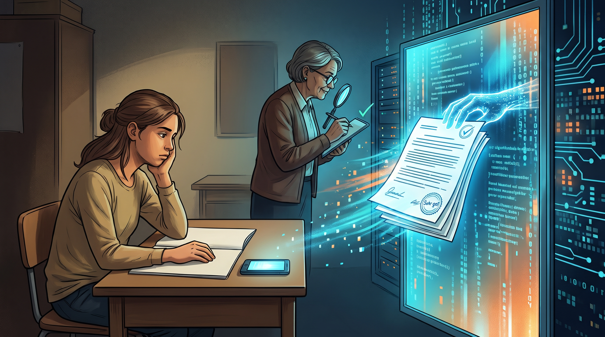
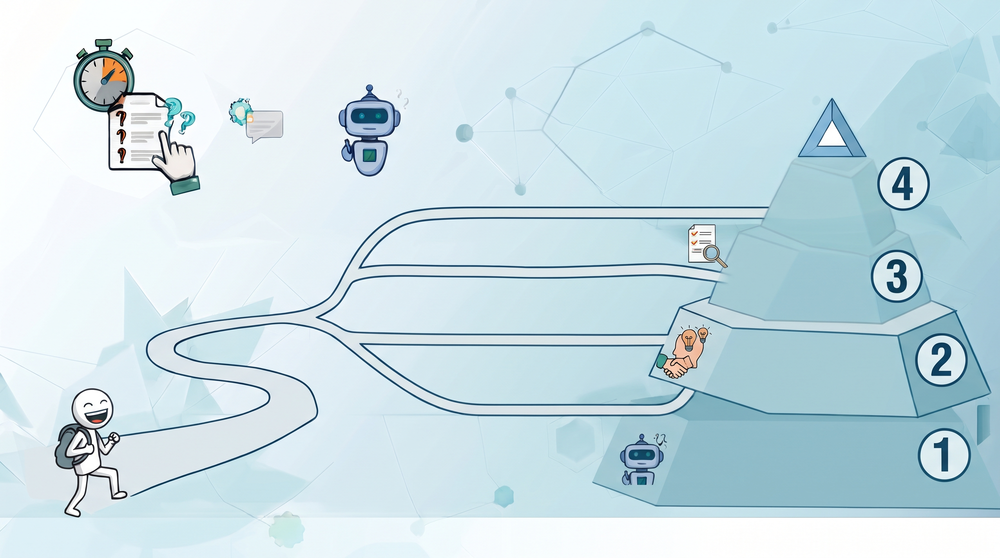
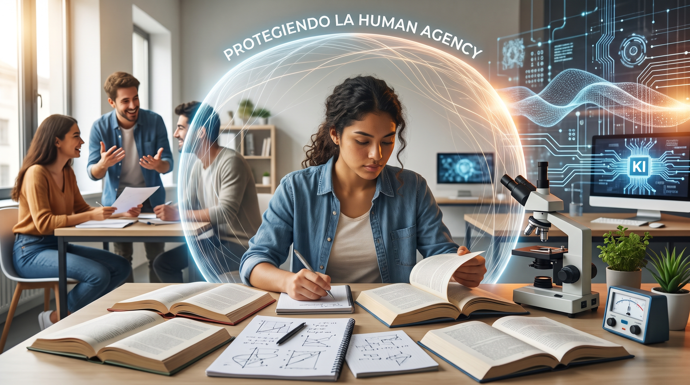
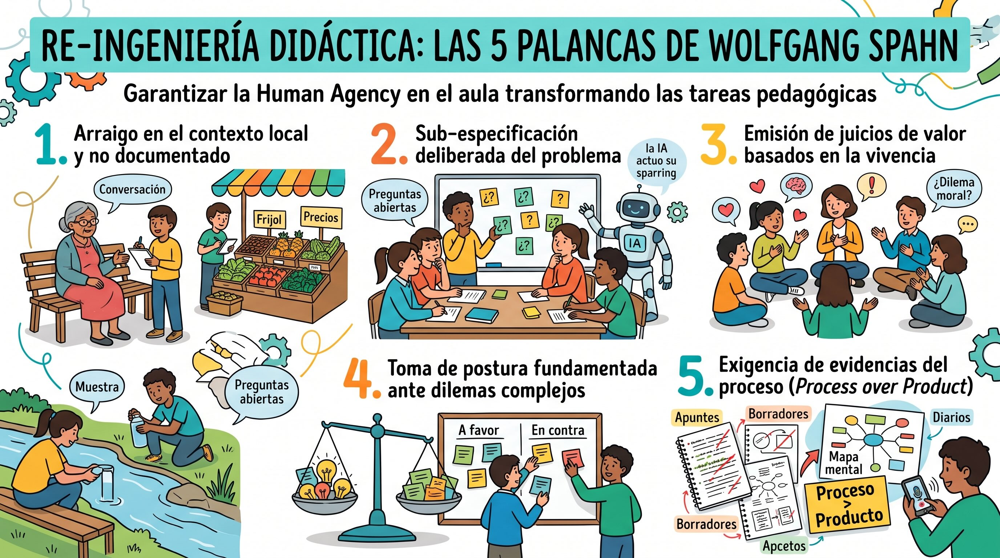

# Módulo 1B: Tareas Escolares bajo la Lupa

**Taller 1 – Parte B (15:30 – 17:00)**\
*Atelier 1: Auditoría de tareas reales, capacidad de acción humana (UNESCO) y rediseño didáctico con criterios de resistencia cognitiva*

------------------------------------------------------------------------

## 1. Punto de partida y objetivos del módulo

### 1.1 La ilusión de la tarea tradicional frente al espejo algorítmico

Durante décadas se asumió una equivalencia implícita: si el reporte escrito estaba bien redactado, el estudiante había leído y comprendido. La llegada de los modelos generativos rompió esa equivalencia. Hoy, un teléfono móvil produce en diez segundos un texto que cumple con todas las rúbricas tradicionales de evaluación. Al calificar únicamente el texto final entregado, la escuela califica con frecuencia la destreza probabilística de un servidor remoto y no el crecimiento cognitivo del estudiante.

{fig-align="center" width="85%"}

::: {.callout-note appearance="simple"}
### ⚡ Micro-actividad reflexiva: «La prueba del espejo» (6 minutos)

**Consigna individual (2 min):** Piense en una tarea escrita o reporte que usted suele asignar en su asignatura y que hasta hace poco consideraba «prueba suficiente» de comprensión lectora o dominio temático.

**Preguntas para el diálogo en parejas (4 min):** 
1. Si un estudiante introduce hoy esa misma consigna en un asistente de texto (como ChatGPT), ¿cuánto del texto final reflejaría su comprensión real y cuánto la elocuencia estadística del algoritmo? 

2. Si usted tuviera que calificar esa entrega a ciegas, ¿qué elementos del reporte le permitirían distinguir con certeza el aprendizaje biológico frente a la generación artificial? 

3. ¿Qué aspecto del proceso de trabajo quedó invisible al evaluar únicamente el producto final entregado?
:::

### 1.2 ¿Qué se espera lograr en este módulo?

{fig-align="center" width="85%"}

Se espera que los docentes:

- **Experimenten de forma directa** la vulnerabilidad de las tareas escolares tradicionales frente a un Modelo de Lenguaje (LLM) mediante una prueba de choque algorítmico.
- **Comprendan los fundamentos** de la *Capacidad de acción humana* [@unesco2025] y los cinco criterios didácticos de Wolfgang Spahn [@spahn2026] para formular consignas resistentes.
- **Colaboren en equipos** mediante una dinámica de rompecabezas (*Gruppenpuzzle*) para auditar y transformar una tarea escolar real en un dispositivo pedagógico que demande esfuerzo intelectual propio, juicio ético y anclaje vivencial.
- **Apliquen la perspectiva tridimensional** del Triángulo de Dagstuhl [@gi2023; @losch2025] al análisis de herramientas educativas.

------------------------------------------------------------------------

## 2. Lectura conceptual aplicada: Deconstrucción y rediseño didáctico (15 Minutos)

### 2.1 Fundamentos didácticos: Tipologías de tareas y ciclo de aprendizaje según Leisen y Adamina

En la enseñanza orientada al desarrollo de competencias, las tareas y consignas no son simples instrumentos de comprobación burocrática, sino los mediadores decisivos entre el estudiante y el objeto de conocimiento [@adamina2014; @newmann1996]. Como argumenta Josef Leisen [@leisen2011], las competencias no se transmiten de manera abstracta ni se adquieren memorizando definiciones descontextualizadas; se desarrollan únicamente cuando la consigna sitúa al aprendiz en un **manejo activo y reflexivo del saber** (*handelnder Umgang mit Wissen*) frente a situaciones reales y significativas.

#### El modelo del ciclo de enseñanza-aprendizaje (*Lehr-Lern-Modell*) de Leisen

Para estructurar un proceso de aprendizaje profundo y evitar que la tarea se reduzca a una entrega superficial, Leisen propone un recorrido pedagógico articulado en seis fases interconectadas:

1. **Descubrir y desplegar la situación problema:** El estudiante entra en contacto con un contexto auténtico que despierta preguntas genuinas y genera un conflicto cognitivo.
2. **Desarrollar representaciones e ideas previas:** Se explicitan los modelos mentales e hipótesis iniciales de los aprendices antes de consultar nuevas fuentes.
3. **Procesar materiales de aprendizaje:** El sujeto interactúa activamente con información, textos, datos o experimentos para construir respuestas fundamentadas.
4. **Construir y negociar un producto de aprendizaje:** El conocimiento adquirido se concreta en un producto intermedio (un mapa conceptual, un borrador, una propuesta) que se discute y contrasta en comunidad.
5. **Definir la ganancia conceptual:** El aprendiz hace consciente su propio avance al comparar sus saberes iniciales con los conceptos recientemente construidos.
6. **Consolidar, ejercitar y descontextualizar:** El nuevo conocimiento se transfiere y automatiza en redes conceptuales más amplias y en problemas nuevos.

Por su parte, Marco Adamina [@adamina2014] señala que este ciclo solo funciona si los materiales didácticos promueven una **diferenciación natural**: tareas abiertas con múltiples puntos de acceso y ritmos de resolución variados que obligan al estudiante a regular activamente sus propios procesos metacognitivos.

::: {.callout-note appearance="simple"}
## 📖 Glosario: Tipología y conceptos de tareas pedagógicas

<b>Haga clic aquí para desplegar las definiciones clave (Leisen, 2011; Adamina, 2014)</b>

 

- **Tarea de aprendizaje / descubrimiento (*Lernaufgabe*):** Consigna orientada a la adquisición e indagación activa de nuevos saberes. Plantea un desafío situado que activa representaciones previas y guía al estudiante en la construcción de nuevos conceptos y modelos explicativos.
- **Tarea de ejercitación y afianzamiento (*Übungsaufgabe*):** Actividad enfocada en la consolidación, profundización y automatización de procedimientos y conceptos previamente aprendidos. Busca descontextualizar el saber para aplicarlo con seguridad en situaciones variadas y estructurar la memoria a largo plazo.
- **Producto de aprendizaje (*Lernprodukt*):** Artefacto tangible o discursivo (informe, mapa conceptual, respuesta argumentada, diseño) generado por los alumnos durante la tarea. No representa el resultado evaluativo final, sino una plataforma intermedia para negociar significados, debatir y visibilizar errores.
- **Manejo activo del conocimiento (*Handelnder Umgang mit Wissen*):** Principio central según el cual el conocimiento no se adquiere mediante recepción pasiva, sino al usarlo activamente para resolver problemas, comunicar ideas a destinatarios concretos o formular juicios fundamentados.
- **Diferenciación natural (*Natürliche Differenzierung*):** Diseño de entornos y consignas abiertas sobre un mismo objeto de estudio que permiten múltiples accesos, diversas estrategias de solución y ritmos de trabajo sin necesidad de fragmentar artificialmente al grupo escolar.

:::

### 2.2 La ruptura algorítmica: Pérdida de la *Acción Humana* (Human Agency, UNESCO, 2025)

El colapso de las tareas escolares tradicionales no obedece a la potencia computacional en sí, sino a una deficiencia de diseño: la proliferación de **consignas deslocalizadas y cerradas** (*«Explique las causas de la independencia»*, *«Resuma el ciclo celular»*). Este tipo de solicitudes demanda un producto final estándar que un modelo de lenguaje resuelve de extremo a extremo sin mediación del sujeto.

{fig-align="center" width="85%"}

Como advierte el *Marco de Competencias Docentes en IA* de la UNESCO (2025), esta delegación pasiva destruye la **capacidad de acción humana (*Human Agency*)**: el estudiante se convierte en un operador que traslada texto de una interfaz a otra, extinguiendo el esfuerzo germano necesario para integrar esquemas y perdiendo la autoría de sus ideas. Al no existir indagación biológica ni confrontación de hipótesis, se acumula la «deuda cognitiva» y la comprensión real se desvanece.

::: {.callout-note appearance="simple"}
### ⚡ Mini-ejercicio: «El termómetro de la agencia» (3 Minutos)

**Consigna en parejas (1 min reflexión personal + 2 min diálogo):**

Analicen la siguiente consigna escolar estándar:  

  <b>📋 Consigna a analizar:</b> 
  <i>«Lee el capítulo 4 sobre la Revolución Industrial y redacta un ensayo de 500 palabras explicando tres causas económicas y dos consecuencias sociales.»</i>

1. **Reparto del esfuerzo mental (0 % a 100 %):**  
   Si un estudiante utiliza un asistente de IA para resolverla, ¿qué porcentaje del esfuerzo cognitivo real (búsqueda, síntesis, redacción, toma de postura) ejecuta la máquina y qué porcentaje conserva el estudiante?
2. **El punto de quiebre:**  
   ¿En qué momento exacto de esa instrucción el alumno pierde por completo la autoría de su propio aprendizaje?
3. **Micro-intervención:**  
   ¿Qué única condición o pregunta le agregarían a esa consigna para obligar al alumno a recuperar de inmediato al menos un 50 % del control sobre el pensamiento?

<b>💡 Haga clic aquí para ver propuestas de micro-intervención</b>

 

Para recuperar de inmediato la capacidad de acción y el juicio del estudiante, basta con añadir una de estas tres condiciones:

- **Opción A (Anclaje local y vivencial):**  
  *«...y compara una de esas consecuencias sociales con las condiciones laborales actuales en una maquila o fábrica de tu propio municipio o departamento.»*  
  *(La IA carece de la experiencia situada y el contexto territorial del estudiante).*
- **Opción B (Dilema ético y toma de postura explícita):**  
  *«...y asume el rol de un obrero textil de 1830: escribe una carta a tu familia justificando si apoyas o rechazas la destrucción de los telares mecánicos (movimiento ludista).»*  
  *(Exige empatía histórica, juicio valorativo y perspectiva en primera persona).*
- **Opción C (Evidencia visible de proceso):**  
  *«...adjunta una fotografía de tu mapa conceptual inicial hecho a mano y explica en un audio de 60 segundos qué argumento descartaste y por qué antes de redactar el texto final.»*  
  *(Fuerza la mediación reflexiva y la transparencia del trayecto cognitivo).*

:::

::: {.callout-warning appearance="simple"}
## ⚠️ El quiebre del ciclo de aprendizaje por el atajo digital

<b>Haga clic aquí para examinar cómo la IA sustituye las fases formativas</b>

 

- **Anulación del descubrimiento:** El estudiante no problematiza contradicciones ni activa sus representaciones iniciales; el bot proporciona explicaciones acabadas que eliminan la sorpresa y la duda productiva.
- **Falsa automatización en la ejercitación:** En lugar de entrenar la aplicación y el razonamiento procedimental, la respuesta automática crea una «ilusión de fluidez» sin afianzamiento en la memoria a largo plazo.
- **Pérdida de validez evaluativa:** Si el producto final se construye con un solo clic, la evaluación sumativa tradicional pierde su capacidad de comprobar el dominio competencial individual.

:::

### 2.3 Re-ingeniería didáctica

Garantizar la *Human Agency* en el aula no se logra prohibiendo las herramientas digitales ni limitándose a dictar talleres de «prompts avanzados». Requiere un **re-engineering de las tareas pedagógicas** para que el valor de la actividad resida en el proceso reflexivo del estudiante y no en la producción mecánica de un texto. La IA generativa puede incorporarse como un interlocutor dialógico o *sparring*, pero el núcleo de la decisión, la recolección de datos y la toma de postura debe permanecer innegociablemente en el aprendiz.

Para asegurar esta resistencia cognitiva y pedagógica, Wolfgang Spahn formula cinco palancas esenciales de rediseño:

{fig-align="center" width="90%"}

::: {.callout-note appearance="simple"}
## 🔍 Explicación pedagógica profunda: Las 5 palancas de Wolfgang Spahn

<b>Haga clic aquí para desplegar el análisis detallado y orientaciones prácticas</b>

 

Para neutralizar la automatización pasiva provocada por los modelos generativos y devolver al aprendiz el protagonismo de su propio pensamiento, Wolfgang Spahn plantea que el rediseño de las consignas debe apoyarse en cinco palancas didácticas interconectadas:

1. **Arraigo en el contexto local y no documentado:**  
   Esta estrategia consiste en anclar la tarea en fuentes directas y vivenciales de la comunidad inmediata del estudiante, las cuales quedan por definición fuera de la base de datos de cualquier modelo de inteligencia artificial. Se logra al solicitar entrevistas orales con vecinos o familiares en el cantón, el relevamiento de precios reales en el mercado municipal del día o el análisis in situ de la flora o el agua de la quebrada cercana. Al exigir insumos no digitalizados, el estudiante no puede delegar el inicio de la investigación en una máquina, convirtiéndose en el único recolector legítimo de los datos.

2. **Sub-especificación deliberada del problema:**  
   En lugar de formular consignas rígidas con fórmulas cerradas y datos predigeridos, el docente presenta situaciones abiertas, incompletas o deliberadamente ambiguas. El propósito central es que el alumno asuma el rol activo de definir los límites del problema, explicitar y justificar sus propios supuestos y seleccionar las variables pertinentes antes de realizar cualquier cálculo o redacción final. La IA puede utilizarse aquí únicamente como un interlocutor o sparring para explorar ideas, pero la delimitación conceptual recae de manera exclusiva en el juicio del estudiante.

3. **Emisión de juicios de valor basados en la vivencia:**  
   Los conceptos curriculares abstractos adquieren relevancia formativa cuando se confrontan con experiencias biográficas intransferibles, emociones genuinas y dilemas éticos reales. En vez de solicitar una definición teórica y distante, la consigna demanda una valoración situada: el estudiante debe juzgar cómo afecta una problemática a su propio entorno familiar, a sus proyectos de vida o a sus valores morales. Dado que un algoritmo no posee conciencia ni vivencias emocionales, la voz del aprendiz se vuelve irremplazable.

4. **Toma de postura fundamentada ante dilemas complejos:**  
   Esta palanca sitúa al aprendiz frente a controversias donde no existe una única respuesta correcta, sino múltiples perspectivas legítimas que entran en tensión (por ejemplo, el equilibrio entre desarrollo económico y preservación ambiental). La consigna exige que el estudiante elija una posición, la defienda con argumentos sólidos y anticipe las posibles objeciones de quienes sostienen visiones contrapuestas. De este modo, la tarea se transforma en un ejercicio riguroso de deliberación crítica y contraste de evidencias que trasciende el resumen neutral que entrega la tecnología.

5. **Exigencia de evidencias del proceso (*Process over Product*):**  
   Frente al riesgo de que la IA genere un informe final pulido en cuestión de segundos, la evaluación didáctica traslada su foco desde el producto terminado hacia la transparencia del camino cognitivo. El docente solicita como requisitos obligatorios de entrega los borradores intermedios, notas y bocetos a mano alzada en el cuaderno, mapas conceptuales elaborados en equipo, bitácoras breves que expliquen qué ideas iniciales se descartaron y por qué, o defensas orales y dialógicas frente al grupo. La validez del aprendizaje radica en hacer visible el esfuerzo reflexivo y la mediación del estudiante durante todo el trayecto.

:::

::: {.callout-tip appearance="simple"}
## 💡 Caso práctico comparativo de Re-Engineering

<b>Haga clic aquí para ver la transformación concreta de una consigna escolar</b>

 

| Dimensión | Tarea tradicional (Vulnerable a la IA) | Tarea rediseñada (Resistente y con Agencia Humana) |
|:---|:---|:---|
| **Consigna** | *«Elabore un informe escrito sobre el impacto de la inflación en la economía familiar y cite tres causas principales.»* | *«Visite el mercado de su cantón y compare el precio actual de tres productos básicos con el presupuesto de una familia local. Formule una hipótesis sobre qué decisión de consumo debieron modificar este mes y confróntela con dos opiniones recogidas en su comunidad.»* |
| **Rol del estudiante** | Operador pasivo: copia la pregunta en el chat, genera el texto y entrega el archivo. | Investigador activo: recoge datos empíricos, entrevista, formula supuestos y elabora conclusiones situadas. |
| **Rol de la IA** | Sustituto total del pensamiento. | Asistente metodológico (*sparring*): ayuda a diseñar las preguntas de la entrevista o contrasta los datos hallados con estadísticas macroeconómicas. |
| **Evidencia evaluada** | El producto estático (fácil de automatizar). | **El proceso:** Borradores a mano, audios de entrevistas, toma de postura y defensa oral. |

:::

### 2.4 La triple mirada del Triángulo de Dagstuhl

Para que el rediseño didáctico de sus tareas sea verdaderamente integral, no basta con evaluar el uso práctico de una aplicación; es indispensable contemplar de forma simultánea las tres perspectivas formativas del modelo de Dagstuhl (tecnológica, sociocultural y de aplicación). Como docentes, les invitamos a someter su propia consigna a esta triple interrogación: analizar qué procesos algorítmicos automatiza el sistema, reflexionar sobre cómo impacta en la autoría y la dinámica vincular de sus estudiantes, y definir con qué intención pedagógica deciden mediar su utilización en el aula. Al cruzar estas tres dimensiones en su propuesta, garantizarán que el dispositivo educativo trascienda la fascinación técnica y se oriente decididamente a proteger la capacidad de acción humana.

| Dimensión | Pregunta clave de análisis | Foco en la tarea escolar |
|:---|:---|:---|
| **Tecnológica** *(¿Cómo funciona?)* | ¿Qué capacidades probabilísticas, limitaciones o sesgos técnicos determinan el comportamiento del sistema? | Comprender qué operaciones cognitivas automatiza la herramienta y cuáles exceden sus capacidades algorítmicas. |
| **Socio-Cultural** *(¿Qué efectos produce?)* | ¿Cómo transforma la herramienta las relaciones interpersonales, la soberanía de los datos y el ecosistema del aula? | Evaluar el impacto en la autoría del estudiante, la privacidad de la información y la distribución de poder en el proceso evaluativo. |
| **Didáctico-Práctica** *(¿Cómo se media?)* | ¿Qué andamiaje pedagógico y fricción activa se requieren para potenciar el aprendizaje genuino? | Diseñar consignas resistentes con anclaje vivencial y evidencias visibles del trayecto reflexivo. |

![**El Triángulo de Dagstuhl para la Educación Digital [@gi2023; @losch2025]:** Las tres dimensiones de análisis crítico (tecnológica, sociocultural y didáctico-práctica) aplicadas a las tareas escolares.](assets/Dagstuhl_Modell.jpeg){fig-align="center" width="85%"}

::: {.callout-note appearance="simple"}
## 🔍 Marco Teórico: El Modelo del Triángulo de Dagstuhl (GI, 2016)

<b>Haga clic aquí para desplegar el origen, función y perspectivas clave</b>

 

#### 1. Origen histórico e institucional
El modelo surge de la **Declaración de Dagstuhl** (*Dagstuhl-Erklärung: Bildung in der digitalen vernetzten Welt*), consensuada en marzo de 2016 durante un seminario intersectorial en *Schloss Dagstuhl – Centro Leibniz para la Informática*. Fue formulado conjuntamente por la **Gesellschaft für Informatik (GI)** junto con expertos en didáctica de la informática, pedagogía de los medios (*Medienpädagogik*), la industria tecnológica y la práctica escolar.

#### 2. Función pedagógica en el aula
El modelo responde a la necesidad de superar la visión reduccionista que equipara la «educación digital» únicamente con el adiestramiento instrumental en aplicaciones de oficina o tabletas. Su función central es proporcionar una **matriz didáctica integral** que garantice la autonomía y la capacidad de juicio crítico de los estudiantes frente a cualquier fenómeno, artefacto o sistema del mundo digital interconectado. Postula que solo la intersección continua de las tres perspectivas permite una comprensión sostenible.

#### 3. Los tres vértices de análisis (Contenidos nucleares)
Para analizar críticamente una tarea escolar o un sistema de IA, el modelo exige formular simultáneamente tres preguntas interconectadas:

- **Perspectiva tecnológica (*¿Cómo funciona esto?* / *Wie funktioniert das?*):** Indaga y evalúa el funcionamiento interno y los principios estructurales de los sistemas digitales (algoritmos, modelos probabilísticos, arquitecturas cliente-servidor). Proporciona los conceptos de fondo necesarios para comprender qué operaciones puede automatizar el software y cuáles son sus límites técnicos.
- **Perspectiva sociocultural (*¿Qué impacto tiene?* / *Wie wirkt das?*):** Examina las interacciones e impactos recíprocos entre los sistemas digitales, los individuos y la sociedad. Analiza cuestiones como la soberanía y privacidad de los datos, la transformación de las relaciones humanas, la autoría del estudiante, las repercusiones éticas y los sesgos algorítmicos.
- **Perspectiva de aplicación (*¿Cómo lo utilizo?* / *Wie nutze ich das?*):** Se centra en la selección deliberada, eficiente y contextualizada de herramientas para alcanzar propósitos individuales o colectivos. Implica no solo dominar el manejo técnico del artefacto, sino saber elegir críticamente el medio adecuado según el objetivo didáctico.

:::

------------------------------------------------------------------------

## 3. Dinámica de Taller: El Rompecabezas (*Gruppenpuzzle*) de Auditoría y Rediseño (65 Minutos)

Esta dinámica estructura el trabajo colaborativo en cuatro fases progresivas para transformar tareas reales mediante roles diferenciados y retroalimentación entre pares.

### Fase 1: Grupos de Base y Prueba de Choque Algorítmico (15 Minutos)

Cada docente trabaja en su grupo de base (4 a 5 integrantes). Cada participante selecciona una tarea escolar real de su propia práctica, la somete a prueba en un chatbot desde su dispositivo móvil y completa la siguiente ficha de registro:

| Ficha 1: Registro del Choque Algorítmico |
|:---|
| **Consigna escolar original ingresada al bot:**   |
| **Tiempo de respuesta de la máquina:** `____` segundos. |
| **Si un alumno me entrega esta respuesta exacta en mi escuela:** ¿Qué calificación obtendría de acuerdo con mis criterios habituales? (De 1 a 10): `______` |
| **Diagnóstico del atajo cognitivo:** ¿Qué operaciones mentales fueron anuladas por la máquina? [ ] Comprensión y síntesis lectora [ ] Búsqueda y contrastación de fuentes [ ] Redacción y estructuración gramatical [ ] Relación causal o deducción lógica [ ] Ninguna: la máquina demostró dominio total de la consigna |

El grupo de base elige por consenso **una sola tarea representativa** para ser auditada y rediseñada a lo largo del taller. Cada miembro del grupo asume una dimensión experta de rediseño según las palancas de Wolfgang Spahn:

- **Experto A:** Contexto local no documentado y toma de postura ante dilemas.
- **Experto B:** Sub-especificación del problema y emisión de juicios de valor vivenciales.
- **Experto C:** Evidencias visibles del proceso (*Process over Product*) y evaluación formativa.
- **Experto D:** Integración metodológica de la IA como *sparring* / contraargumento.

---

### Fase 2: Grupos de Expertos y Co-Diseño de Criterios (20 Minutos)

Los participantes se reagrupan por mesas temáticas de expertos (todos los Expertos A juntos, todos los Expertos B juntos, etc.).

**Misión de la mesa de expertos:**

1. Analizar colectivamente las tareas seleccionadas bajo el lente de su criterio asignado.
2. Formular tres estrategias concretas para inyectar resistencia cognitiva a las consignas escolares desde su dimensión.
3. Elaborar una lista de verificación (*checklist*) breve para llevar de vuelta a sus equipos originales.

---

### Fase 3: Retorno a Grupos de Base, Re-Engineering y Papelógrafo (20 Minutos)

Los expertos regresan a sus grupos de base originales. Cada miembro aporta las estrategias desarrolladas en su mesa temática para transformar la tarea seleccionada y plasmar el rediseño en un pliego de papelógrafo:

| Columna 1: Consigna Original | Columna 2: Diagnóstico del Vacío | Columna 3: Tarea Resistente (Rediseño) |
|:---|:---|:---|
| Copien textualmente la tarea tradicional seleccionada.  *Ejemplo:* «Investigar la biografía del general Manuel José Arce y resumir su papel en la federación centroamericana». | • **Nota estimada con IA:** (1 a 10)  • **Operaciones anuladas:** Describan qué dejó de pensar el alumno cuando el bot redactó el contenido.  • **Riesgo:** Pérdida de esfuerzo propio y lectura aparente. | Redacten la nueva consigna integrando los aportes de los cuatro expertos.  Indiquen con claridad: 1. La nueva instrucción situada. 2. La evidencia del proceso exigida (dibujo, audio, defensa oral, trabajo de campo). 3. Los criterios de Spahn aplicados. |

**Prueba de validación final (últimos 5 min):** Ingresen la consigna rediseñada en el chatbot. Verifiquen si el modelo ya no puede resolverla de forma autónoma sin la intervención vivencial y metodológica del estudiante.

---

### Fase 4: Galería de Aprendizaje y Cierre Plenario (10 Minutos)

- **5 min - Circulación activa:** Todos los equipos fijan sus papelógrafos en las paredes de la sala. Los participantes recorren la galería en silencio leyendo las propuestas de sus colegas y añadiendo notas adhesivas (*Post-its*) con preguntas o sugerencias de mejora.
- **5 min - Síntesis reflexiva:** La facilitación destaca dos casos representativos de reingeniería y sintetiza el principio formativo de la sesión: blindar las tareas escolares no consiste en evadir la inteligencia artificial, sino en elevar el nivel de exigencia hacia la agencia y el pensamiento humano.

::: {.callout-tip appearance="simple"}
## 🛠️ Para seguir profundizando: Ingeniería de instrucciones con Anthropic (Claude)

Una vez rediseñada la consigna sobre el papel, el siguiente paso práctico consiste en dialogar eficazmente con el modelo para generar andamiajes, rúbricas o actuar como *sparring* socrático. 

Para dominar la estructuración de instrucciones precisas (*prompt engineering*), les recomendamos consultar la documentación y guías oficiales de Anthropic en español:

- 🌐 **Documentación oficial:** [Anthropic Claude – Guía y Documentación en Español](https://platform.claude.com/docs/es/home){target="_blank"}
- **Claves aplicables al aula:** 
  - Asignación de roles claros (*system prompts*) para que la IA actúe como tutor guiado y no como sustituto del estudiante.
  - Inclusión de restricciones de formato y contexto para evitar respuestas genéricas o alucinaciones.
  - Uso de ejemplos concretos (*few-shot prompting*) para calibrar el tono didáctico y el nivel cognitivo de las respuestas.
:::

------------------------------------------------------------------------

## 4. Registro personal en el dossier de aprendizaje

*(Complete esta ficha de forma manuscrita o en el formulario digital del programa)*:

| Registro individual de la tarea rediseñada |
|:---|
| **Asignatura y grado destinatario:**   |
| **Consigna escolar re-diseñada y enriquecida:**     |
| **Criterios de Wolfgang Spahn incorporados en el diseño:** [ ] Contexto local / comunitario no documentado en la web [ ] Sub-especificación deliberada (problema abierto) [ ] Juicio de valor y anclaje vivencial/emocional [ ] Toma de postura fundamentada ante dilemas [ ] Evidencias visibles del proceso (*Process over Product*) |
| **Evidencia de aprendizaje exigida al estudiante:** *(Describa qué entregará o demostrará el alumno: bitácora a mano, entrevista comunitaria, audio explicativo, debate oral, etc.)*   |

------------------------------------------------------------------------

## 5. Referencias del Módulo 1B

Las citas bibliográficas de este módulo [@adamina2014; @gi2023; @leisen2011; @losch2025; @newmann1996; @spahn2026; @unesco2025] están vinculadas interactivamente. Consulte el listado completo en [Referencias Bibliográficas](references.qmd).